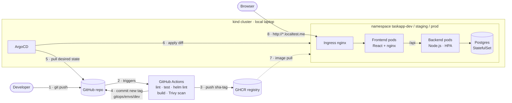

# GitOps Platform — TaskApp

[](https://github.com/ayush-anand01/gitops-platform/actions/workflows/ci.yml)


A production-style **GitOps delivery platform** that runs entirely on a laptop.
A React + Node.js + PostgreSQL app is tested, security-scanned and packaged by **GitHub Actions**,
described by a **Helm** chart, and continuously deployed by **ArgoCD** to **dev, staging and prod**
on a local multi-node **kind** Kubernetes cluster. Promotion between environments is a pull request;
rollback is a `git revert`.

---

## Contents

- [Architecture](#architecture)
- [Features](#features)
- [Tech stack](#tech-stack)
- [Quick start](#quick-start)
- [The deployment flow](#the-deployment-flow)
- [Environments](#environments)
- [Repository layout](#repository-layout)
- [Documentation](#documentation)
- [Roadmap](#roadmap)

---

## Architecture



**Key idea:** CI never touches the cluster. CI's last step is a Git commit; ArgoCD, running *inside*
the cluster, pulls that change and reconciles. Cluster credentials never leave the cluster, every
deployment is an auditable commit, and manual drift is reverted automatically.

See [docs/ARCHITECTURE.md](docs/ARCHITECTURE.md) for the detailed design.

## Features

**Delivery**
- GitOps continuous delivery with an ArgoCD **ApplicationSet** (one Application per environment) and an **AppProject** security boundary
- Auto-sync with `prune` + `selfHeal` for dev and staging; a **manual sync gate** for prod
- **Build once, deploy many**: the same immutable `sha-<commit>` image is promoted dev → staging → prod via pull requests
- Rollback with `git revert` (or ArgoCD history in an emergency)

**CI and security**
- Parallel lint and unit tests (matrix), Helm lint + render for every environment
- Multi-stage Docker builds with GitHub Actions layer cache
- **Trivy** security gate: images with fixable HIGH/CRITICAL CVEs are never pushed
- Least-privilege workflow permissions, no cluster credentials in CI, Dependabot for npm, Docker and Actions

**Kubernetes practices**
- Liveness vs readiness probes, graceful `SIGTERM` shutdown, zero-downtime rolling updates (`maxUnavailable: 0`)
- **HPA** (2–5 pods on CPU) and **PodDisruptionBudgets** in prod
- Restricted security context: non-root numeric UID, read-only root FS, all capabilities dropped, seccomp `RuntimeDefault`
- Resource requests/limits everywhere; config-checksum annotation to roll pods on config changes
- PostgreSQL as a **StatefulSet** with a headless Service and persistent volume

**Observability-ready**
- Prometheus `/metrics` endpoint with RED metrics (`http_requests_total`, `http_request_duration_seconds`)
- `/api/info` and a UI badge show environment, version and pod name, so you can see a rollout happen

## Tech stack

| Layer | Tool |
| --- | --- |
| Frontend | React 19, TypeScript, Vite, nginx (unprivileged) |
| Backend | Node.js 22, Express 5, `pg`, `prom-client` |
| Database | PostgreSQL 16 |
| Containers | Docker (multi-stage), Docker Compose |
| Kubernetes | kind (1 control plane + 2 workers), ingress-nginx, metrics-server |
| Packaging | Helm 3 |
| GitOps CD | ArgoCD (ApplicationSet, AppProject) |
| CI | GitHub Actions, GHCR |
| Security | Trivy, Dependabot, Pod Security (restricted profile) |
| Validation | `helm lint`, kubeconform, ESLint, `tsc`, `node --test` |

Why each was chosen: [docs/DESIGN-DECISIONS.md](docs/DESIGN-DECISIONS.md).

## Quick start

### Option A — just the app (Docker Compose, ~2 minutes)

```bash
git clone https://github.com/ayush-anand01/gitops-platform.git
cd gitops-platform
docker compose up --build
# open http://localhost:8080
```

### Option B — the full GitOps platform

Prerequisites: Docker Desktop (≥ 8 GB memory for Docker), `kind`, `kubectl`, `helm`.
On Windows run the scripts from **Git Bash** or **WSL**.

```bash
./scripts/bootstrap.sh
```

The script creates the kind cluster, installs ingress-nginx, metrics-server and ArgoCD, registers the
apps, and prints the ArgoCD admin password.

```bash
kubectl -n argocd port-forward svc/argocd-server 8081:443
# ArgoCD UI → https://localhost:8081  (user: admin)
```

Full walkthrough, including Windows tool installation and the end-to-end demo:
[docs/SETUP.md](docs/SETUP.md).

## The deployment flow

| Step | What happens | Where |
| --- | --- | --- |
| 1 | Push to `main` | Developer |
| 2 | Lint, unit tests, Helm lint for dev/staging/prod | `ci.yml` → `test`, `helm-lint` |
| 3 | Build images, **Trivy scan**, push `sha-<commit>` + `latest` to GHCR | `ci.yml` → `build` |
| 4 | Commit the new tag to `gitops/envs/dev/values.yaml` | `ci.yml` → `deploy-dev` |
| 5 | ArgoCD detects the commit and syncs `taskapp-dev` | in-cluster |
| 6 | Run **Promote** (dev → staging), review and merge the PR | `promote.yml` |
| 7 | ArgoCD syncs staging automatically | in-cluster |
| 8 | Promote staging → prod, merge, click **Sync** in ArgoCD | `promote.yml` + ArgoCD UI |

Pull requests run steps 2–3 (without pushing), so every change is verified before merge.

## Environments

| | dev | staging | prod |
| --- | --- | --- | --- |
| URL | http://dev.taskapp.localtest.me | http://staging.taskapp.localtest.me | http://taskapp.localtest.me |
| Namespace | `taskapp-dev` | `taskapp-staging` | `taskapp-prod` |
| Backend replicas | 1 | 2 | HPA 2–5 @ 70% CPU |
| PodDisruptionBudget | — | ✓ | ✓ |
| ArgoCD sync | automatic | automatic | **manual** |
| Updated by | CI on every push | Promote PR | Promote PR + manual sync |

`*.localtest.me` is public DNS that always resolves to `127.0.0.1`, so no hosts-file changes are needed.

## Repository layout

```
gitops-platform/
├── app/
│   ├── backend/            Node.js API — routes, probes, metrics, tests, Dockerfile
│   └── frontend/           React + Vite UI, nginx config template, Dockerfile
├── charts/taskapp/         Helm chart shared by all environments
├── gitops/
│   ├── envs/               dev | staging | prod values — the only files CI edits
│   └── argocd/             AppProject + ApplicationSet
├── infra/kind-config.yaml  3-node kind cluster, ports 80/443 mapped to host
├── scripts/                bootstrap.sh · promote.sh · teardown.sh
├── docs/                   architecture, setup, design decisions, runbook
├── .github/                CI + promote workflows, Dependabot, PR template
└── docker-compose.yml      local development without Kubernetes
```

## Documentation

| Doc | What's in it |
| --- | --- |
| [docs/ARCHITECTURE.md](docs/ARCHITECTURE.md) | Components, request path, GitOps model, environments |
| [docs/SETUP.md](docs/SETUP.md) | Step-by-step setup on Windows/macOS/Linux and the end-to-end demo |
| [docs/DESIGN-DECISIONS.md](docs/DESIGN-DECISIONS.md) | Why each tool and pattern was chosen, with alternatives |
| [docs/RUNBOOK.md](docs/RUNBOOK.md) | Day-2 operations: deploy, promote, rollback, debug, troubleshooting |
| [charts/taskapp/README.md](charts/taskapp/README.md) | Helm chart values reference |
| [app/backend/README.md](app/backend/README.md) | API endpoints, configuration, local development |
| [app/frontend/README.md](app/frontend/README.md) | UI, nginx proxy, local development |

## Roadmap

- [x] Containerised 3-tier app with Docker Compose
- [x] Helm chart with per-environment values
- [x] ArgoCD GitOps across dev / staging / prod
- [x] CI with Trivy security gate and automated dev deploys
- [x] PR-based promotion workflow
- [ ] Observability: kube-prometheus-stack, Grafana dashboard, SLO alerts, Loki
- [ ] Progressive delivery: Argo Rollouts canary with Prometheus analysis
- [ ] Secrets & policy: Sealed Secrets, Kyverno, Cosign image signing
- [ ] Infrastructure as Code: Terraform bootstrap (app-of-apps)
- [ ] Resilience: k6 load tests to demo HPA, Chaos Mesh experiments

## License

[MIT](LICENSE) © 2026 Ayush Anand
