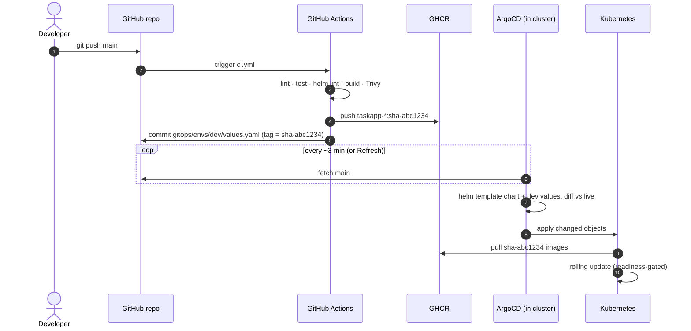
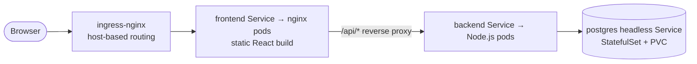
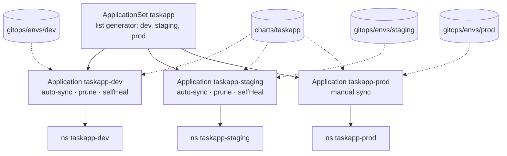
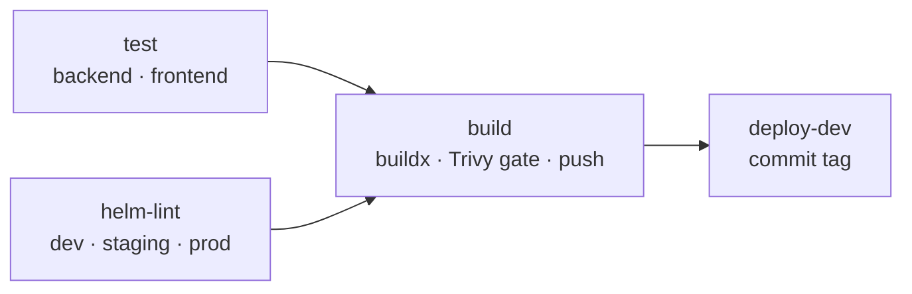

# Architecture

## Overview

The platform has three parts that never talk to each other directly — they meet in Git:

| Part | Runs where | Responsibility |
| --- | --- | --- |
| **CI** (GitHub Actions) | GitHub-hosted runners | Prove a commit is good, publish images, record the new tag in Git |
| **Git** (this repo) | GitHub | Single source of truth for code *and* desired cluster state |
| **CD** (ArgoCD) | Inside the Kubernetes cluster | Pull desired state from Git and reconcile the cluster to match |

## Application

- **Single origin.** The browser only talks to the frontend; nginx proxies `/api/` to the backend
  Service. No CORS, and the backend is never exposed outside the cluster.
- **Stateless tiers scale horizontally.** Frontend and backend are Deployments; the backend has an HPA in prod.
- **Stateful tier is pinned.** Postgres is a single-replica StatefulSet with its own PersistentVolumeClaim
  and a headless Service (`taskapp-postgres`) for stable DNS.

### Backend endpoints

| Endpoint | Purpose |
| --- | --- |
| `GET /healthz` | Liveness — process is up (never checks dependencies) |
| `GET /readyz` | Readiness — DB reachable (`SELECT 1`), else 503 |
| `GET /metrics` | Prometheus metrics (RED + Node.js process metrics) |
| `GET /api/info` | Version (image tag), environment, pod name |
| `/api/tasks` | CRUD for tasks |

## Kubernetes objects (per environment)

| Object | Name | Notes |
| --- | --- | --- |
| Namespace | `taskapp-<env>` | Created by ArgoCD (`CreateNamespace=true`) |
| ConfigMap | `taskapp-config` | `APP_ENV`, DB host/port/name/user |
| Secret | `taskapp-db` | DB password (Sealed Secrets planned) |
| Deployment + Service | `taskapp-backend` | Probes, RollingUpdate `maxUnavailable: 0`, Prometheus annotations |
| HPA | `taskapp-backend` | prod only — 2–5 replicas @ 70% CPU |
| PodDisruptionBudget | `taskapp-backend` | staging + prod — `minAvailable: 1` |
| Deployment + Service | `taskapp-frontend` | nginx, `BACKEND_URL` env |
| StatefulSet + headless Service | `taskapp-postgres` | `volumeClaimTemplates`, `pg_isready` probe |
| Ingress | `taskapp` | class `nginx`, env-specific host |

## GitOps model

- **One chart, many environments.** `charts/taskapp` describes *how* to deploy; `gitops/envs/<env>/values.yaml`
  describes *what* runs where. CI only ever edits the env files, so every deployment is a one-line diff.
- **AppProject `taskapp`** restricts the apps to this repository and to namespaces matching `taskapp-*`.
- **Promotion** copies image tags between env files via a pull request (`promote.yml` → `scripts/promote.sh`).
- **Rollback** is `git revert` of the tag commit; ArgoCD syncs the previous tag.

## CI pipeline

| Job | PR | push to `main` |
| --- | --- | --- |
| `test` | ✓ | ✓ |
| `helm-lint` | ✓ | ✓ |
| `build` (scan) | ✓ | ✓ |
| `build` (push to GHCR) | — | ✓ |
| `deploy-dev` | — | ✓ |

## Local cluster

`infra/kind-config.yaml` creates one control-plane and two worker nodes as Docker containers. Ports 80 and 443 on
the control-plane node are mapped to the host, and the node is labelled `ingress-ready=true` so the kind build of
ingress-nginx schedules there. `metrics-server` (with `--kubelet-insecure-tls` for kind) feeds the HPA.
